<picture>
  <source media="(max-width: 600px)" srcset="./assets/console-mobile.svg">
  
</picture>

  <a href="https://mxnr.net">Writing & talks</a> &nbsp; / &nbsp;
  <a href="https://www.linkedin.com/in/mxnrl/">LinkedIn</a> &nbsp; / &nbsp;
  <a href="https://mxnr.net/contacts/">Get in touch</a>

## Human intent. Agent leverage. Working software.

I'm **Dmitry Siemenov**, a software engineer working at the intersection of product, systems, and AI-assisted development. I use coding agents throughout the engineering loop—from exploring unfamiliar code to implementation, testing, security review, and deployment.

I bring the context, constraints, and judgment. Agents help me explore more options and iterate faster. Tests, browser checks, and measurements tell us whether the result holds up.

### AI in the engineering loop

- **Give agents useful context.** Clear tasks, repository instructions, architectural boundaries, and explicit acceptance criteria.
- **Build a feedback loop.** Implement, inspect the diff, run integration tests, exercise the UI, and feed failures back into the next iteration.
- **Go looking for failure.** Adversarial inputs, authorization checks, upload validation, and performance measurements—not just a happy-path demo.
- **Carry it through to operations.** CI/CD, background jobs, observability, backups, and restore drills belong in the same conversation as the code.

I'm especially interested in agent workflows that stay understandable: scoped permissions, reviewable changes, reproducible checks, and evidence before confidence.

### The build rhythm

Generated daily from the public profile calendar. Contributions include more than commits; activity is not a measure of impact. [How this works](./MAINTENANCE.md).

### Tools, not an identity

`Rust` · `JavaScript` · `PostgreSQL` · `PHP / Symfony` · `AWS` · `Linux` · `Nginx` · `Cloudflare`

I care about the details in a form as much as the transaction behind it. The goal is still clear UX, readable code, fast applications, and systems you can recover when something goes wrong.

### A few things I've shared

- [Writing & conference talks](https://mxnr.net) — architecture, Symfony, AWS, and lessons from building software.
- [gource-multiple](https://github.com/mxnr/gource-multiple) — visualize the history of multiple repositories with Gource.
- [gs-export](https://github.com/mxnr/gs-export) — bulk-import CSV files into Google Sheets, including Korean text.

